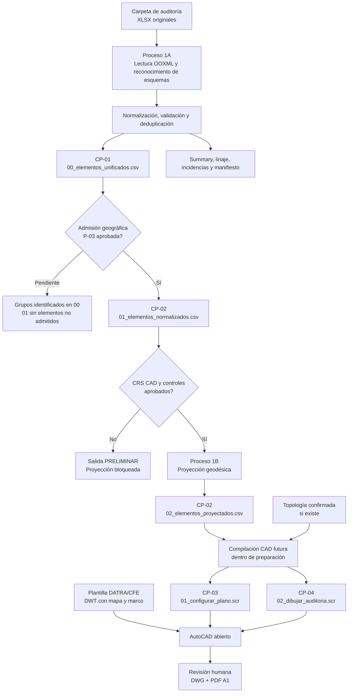

# Pipeline de Auditorías CFE | DATRA

> **Acta conceptual y presentación técnica del repositorio.** Herramienta local para preparar, verificar y representar en AutoCAD levantamientos de infraestructura aérea asociados a auditorías CFE para DATRA.
>
> **Estado al 4 de noviembre de 2026:** CP-01 implementado, auditoría JS ejecutada y **43 pruebas técnicas aprobadas**, sin liberación productiva de datos reales. CP-02 conserva sus precondiciones geográficas; CP-03 y CP-04 siguen pendientes. Este repositorio no constituye una certificación de CFE ni una publicación de inventarios de campo.

## 1. Propósito

Los levantamientos se reciben como libros Excel (`.xlsx`) heterogéneos, en ocasiones con miles de fotografías, fórmulas, hojas ocultas, versiones repetidas y coordenadas inconsistentes. El procedimiento anterior requería normalizar manualmente CSV y ejecutar JavaScript que dibujaba puntos y proponía trayectorias; esa salida era difícil de auditar y podía omitir componentes o producir conexiones incorrectas.

Este proyecto busca un **pipeline local, verificable y reutilizable** que convierta los Excel originales en una lista confiable de componentes y, posteriormente, en dibujos técnicos construidos sobre una **plantilla DATRA/CFE de AutoCAD**, con el menor trabajo manual repetitivo posible y sin perder la trazabilidad de campo.

**Resultado esperado del sistema completo:** seleccionar una auditoría por consola, procesar todos sus XLSX declarados, documentar calidad/duplicados, proyectar coordenadas con CRS verificado, preparar dos scripts `.scr` y ejecutarlos manualmente sobre la plantilla DATRA abierta en AutoCAD; revisar el plano y guardar **DWG + PDF A1 horizontal**.

## 2. Alcance y decisiones rectoras

| Principio | Compromiso del sistema |
|---|---|
| **Fuentes originales** | Los XLSX son la entrada primaria y se tratan como solo lectura. Los CSV históricos son evidencia de regresión, no fuente autoritativa nueva. |
| **Una carpeta, una auditoría** | La CLI elige una carpeta bajo `AuditoriaCFE/auditorias/`. Puede contener varios libros y subrutas, pero genera un plano lógico por auditoría. |
| **Identidad física** | Mismo tipo canónico y coordenada exacta ⇒ candidato duplicado, con excepciones acreditadas para equipos distintos. Una sola representación por componente. |
| **Preservación de evidencia** | Cada registro conserva procedencia, valores crudos e incidencias. Los duplicados se documentan, no se silencian. |
| **Calidad geográfica** | No se corrigen dígitos por conjetura; un valor mundialmente válido no equivale a una ubicación local aprobada. |
| **CRS** | `EPSG:32611` es **candidato**. El CSV CAD proyectado requiere controles geográficos y evidencia del dibujo. |
| **Topología** | La cercanía, el orden de Excel y un DFS **no demuestran** una conexión física. Solo las aristas confirmadas autorizan rutas definitivas. |
| **Presentación** | Una sola lámina **A1 horizontal** por auditoría, utilizando la base cartográfica y un cajetín DATRA editable. |
| **Operación** | Python local, sin base de datos ni servicios cloud; AutoCAD convencional ejecuta los **dos scripts** manualmente. |

La fuente normativa es el [ADR-000](AuditoriaCFE/Docs/ADRs/ADR-000_Decisiones_Base_Pipeline_Auditorias_CFE.md), seguido de la [especificación TO-BE v0.2](AuditoriaCFE/Docs/Specs/Especificacion_Pipeline_Auditorias_CFE_TOBE_v0.2.md). Las propuestas técnicas todavía no aprobadas no sustituyen al ADR.

## 3. Flujo conceptual



Los **cuatro checkpoints** organizan productos y conservan los **dos procesos arquitectónicos**: preparación fuera de AutoCAD y construcción/revisión del plano en AutoCAD. La compilación de los futuros SCR pertenece a la preparación; AutoCAD los ejecutará después. CP-01 puede completarse sin P-03 ni P-06; identificar un grupo no lo aprueba para dibujo. Es posible preparar puntos válidos sin conectividad acreditada y no se deben inventar líneas.

| Checkpoint | Producto y estado |
|---|---|
| **CP-01 — Unificación y deduplicación** | `00_elementos_unificados.csv` implementado; prevalentes identificables, sin exigir aprobación de P-03/P-06. |
| **CP-02 — Preparación cartográfica** | `01_elementos_normalizados.csv` conserva admisión P-03; el auxiliar `02_elementos_proyectados.csv` exige además CRS y controles P-06. |
| **CP-03 — Configuración AutoCAD** | Futuro `01_configurar_plano.scr`; no implementado ni generado. |
| **CP-04 — Construcción de auditoría** | Futuro `02_dibujar_auditoria.scr`; no implementado ni generado. |

## 4. Contrato de salidas

Cada ejecución dispone de salidas en `AuditoriaCFE/auditorias/<nombre>/salida/` y un manifiesto de ejecución verificable fuera de esa carpeta.

| Producto | Finalidad | Estado del código |
|---|---|---|
| `00_elementos_unificados.csv` | Una fila por grupo identificable, con prevalente, ocurrencias, estado de preparación y admisión geográfica separados. No autoriza CAD. | **Implementado — CP-01**, también con P-03/P-06 pendientes. |
| `01_elementos_normalizados.csv` | Elementos únicos admitidos; exactamente `Ruta,Elemento de Red,Coordenadas`. | **Implementado.** Puede contener solo cabecera si faltan reglas de admisión. |
| `summary.csv` | Estado de cada componente, procedencia prevalente, coincidencia informativa con maestro y novedad frente a baseline. | **Implementado.** |
| `linaje_y_calidad.jsonl` / `reporte_incidencias.csv` | Trazabilidad de ocurrencias, duplicados, errores y exclusiones. | **Implementado.** |
| `asociaciones_elemento_ruta.csv` / `resumen_conteos.csv` | Subrutas y conciliación del inventario. | **Implementado.** |
| `topologia_propuesta.csv` | Posibles relaciones **no confirmadas**; puede permanecer vacío. | **Archivo implementado; aristas no inferidas.** |
| `02_elementos_proyectados.csv` | Coordenadas métricas para CAD e identificadores de los elementos. | **Implementado condicionalmente; validado solo con fixture sintético.** |
| `01_configurar_plano.scr` | Preparar/verificar el dibujo abierto desde la DWT DATRA. | **Pendiente — CP-03.** |
| `02_dibujar_auditoria.scr` | Insertar símbolos, etiquetas, numeración, conteos y trazas confirmadas. | **Pendiente — CP-04.** |
| DWG y PDF A1 | Entregables CAD posteriores a revisión humana. | **Pendientes.** |

También se generan perfiles de hojas, filas no operativas, diagnóstico opcional de coordenadas cercanas y manifiestos con hashes. El [contrato auxiliar](AuditoriaCFE/Docs/Specs/Contrato_Salidas_Proceso1_PROPUESTA.md) y la [extensión del CSV 00](AuditoriaCFE/Codex/01_Implementacion_Proceso1/EXTENSION_ETL_UNIFICADO.md) siguen sujetos a aprobación **P-09**. Los contratos 00/01/02 permanecen como están implementados; esta revisión no cambia sus columnas ni condiciones.

## 5. Auditorías previstas

- **Natura:** una auditoría lógica que puede reunir varios Excel y múltiples nombres de subruta.
- **Mirador:** consolidación de archivos y versiones históricas, deduplicando sin perder el linaje.
- **Otay–Florido:** ruta actualizada a partir de distintos tramos y fuentes.
- **Tijuana-General:** versión inicial basada exclusivamente en `Postes_CFE.xlsx`; una versión posterior podrá incorporar ampliaciones verificadas.

Un componente puede aparecer legítimamente en un plano individual y en el plano general. La comparación con el inventario maestro es **informativa** y no lo suprime de la auditoría seleccionada.

## 6. Estado verificable del repositorio

**Corte técnico:** extensión CP-01 del commit [`b3b303a`](https://github.com/CarlosAM03/pipeline-autocad-auditoria-cfe/commit/b3b303aa3862fa90b3a351766d73570ed9772714), posterior a la primera implementación `7baa82c` y al checkpoint [`33364c1`](https://github.com/CarlosAM03/pipeline-autocad-auditoria-cfe/commit/33364c1aa2c94a751857c4d106ee826d8af17ac5). El acta conceptual se incorporó después en `e4d4e9c`; esta revisión de integración no reescribe esos commits.

- **Proceso 1:** CLI Python, lectura OOXML secuencial de cuatro familias, calidad geográfica, prevalencia/deduplicación, comparaciones, proyección bajo evidencia, reportes y manifiestos implementados.
- **Pruebas técnicas ejecutadas:** **43 aprobadas, 0 fallidas y 0 omitidas** en el entorno con originales y Node disponibles: 29 previas, 9 de unificación y 5 de auditoría JS. En otros equipos las clases históricas se omiten explícitamente si faltan sus insumos o Node; no se cuentan como aprobadas. La prueba de no regresión usa un oráculo congelado versionado y ya no necesita el historial de `7baa82c`.
- **Regresión de extracción:** 551 registros históricos Mirador y 969 Otay–Florido antes de deduplicación y nuevas reglas de calidad.
- **Prueba de archivos grandes:** hoja sintética con 1,048,576 nodos de fila XML, sin abrir fotografías.
- **Salidas reales históricas de prueba:** CSV 00 con **494 grupos en Mirador** (incluyendo una copia anterior) y **749 en Otay**; CSV 01 sin componentes admitidos por P-03 pendiente y sin CSV 02 validado por P-06 pendiente. Las ocurrencias rechazadas o sin identidad permanecen en linaje e incidencias.
- **Demo sintética:** cinco grupos en 00 y cuatro componentes admitidos en 01 y proyectados en 02 con controles *ficticios*; **no valida la posición del mapa real**.
- **Topología:** no hay aristas aprobadas ni scripts de rutas implementados.
- **Plantilla:** existe un marco DATRA A1 candidato y una base cartográfica DWG local, pero la **DWT canónica**, los detalles constructivos y los controles CRS no se han dado por cerrados.

La suite ejecutada en el equipo de desarrollo y los bloqueos declarados se documentan en [Pruebas y validación](AuditoriaCFE/Codex/01_Implementacion_Proceso1/PRUEBAS_Y_VALIDACION.md), [Resultado de implementación](AuditoriaCFE/Codex/01_Implementacion_Proceso1/RESULTADO_IMPLEMENTACION.md) y [Pendientes](AuditoriaCFE/Codex/01_Implementacion_Proceso1/PENDIENTES_PARA_REVISION.md). **Pasar pruebas técnicas no aprueba fuentes productivas, perímetro, CRS, topología ni liberación final.** Los resultados locales ignorados por Git no se incluyen en el repositorio.

## 7. Recuperación del código histórico JavaScript

Los archivos originales de referencia son `generar.js`, `ordenar.js` y `trayectoria.js`, custodiados fuera del código productivo, junto a sus CSV y TXT anteriores. **La auditoría técnica ya fue ejecutada y documentada**, con funciones sobre copias aisladas, sin ejecutar MAIN, generar SCR ni abrir AutoCAD. No se portaron los JS como módulos de producción. Véase [AUDITORIA_JS_HISTORICOS.md](AuditoriaCFE/Codex/01_Implementacion_Proceso1/AUDITORIA_JS_HISTORICOS.md).

| Script histórico | Conocimiento recuperable | Lo que **no** se reutiliza como regla nueva |
|---|---|---|
| `generar.js` | Estructura de comandos AutoCAD, capas, etiquetas y regresión exacta de los TXT históricos de puntos. | Parser CSV por `split(',')`, filtro de aislados de 500 m, cálculo UTM aproximado, `PDMODE` global, coordenadas redondeadas en etiquetas y falta de trazabilidad. |
| `ordenar.js` | Nociones de grafo, componentes conexas y DFS con **retorno explícito al nodo padre**. | Umbral de 120 m como prueba de conexión, elección heurística de extremo, recorrido que puede duplicar segmentos al dibujarse como polilínea. |
| `trayectoria.js` | Búsqueda de componentes, nodos con grado 1 y recorrido DFS básico. | Filtro de aislados de 1,000 m, umbral de conexión 120 m, DFS **sin retorno explícito**, capaz de dibujar saltos entre ramas. |

**Verificación independiente:** al ejecutar una copia de `generar.js` con los CSV históricos, se reprodujeron los TXT de puntos de Mirador y Otay–Florido **con contenido idéntico después de normalizar saltos de línea**, con **533** y **965** puntos respectivamente. Esto sirve para pruebas de regresión histórica del futuro generador, **no** demuestra exactitud geográfica ni autoriza los filtros previos.

La auditoría de CP-01 incluye el mapeo **CONSERVAR / REEMPLAZAR / DESCARTAR** y pruebas de regresión. La reproducción de funciones confirmó los **533/965 POINT** en orden y coordenadas frente a los TXT. Verificó retorno al padre en `ordenar.js` y preorden sin retorno en `trayectoria.js`, que introduce saltos entre ramas. La discrepancia de atribución en TO-BE v0.2 está documentada en una [propuesta separada](AuditoriaCFE/Codex/01_Implementacion_Proceso1/PROPUESTA_CHECKPOINTS_CP01_CP04.md); la norma permanece intacta. La auditoría completada **no autoriza generar rutas CAD ni valida los filtros o la fórmula UTM históricos**.

## 8. Instalación y operación del Proceso 1

Requiere **Windows / Python 3.10+** para el entorno operativo previsto. El ETL usa principalmente biblioteca estándar; `pyproj` proporciona la proyección y geodesia.

Desde la raíz del repositorio, con un intérprete Python instalado y accesible:

```powershell
py -3.10 -m venv .\AuditoriaCFE\.venv
& .\AuditoriaCFE\.venv\Scripts\python.exe -m pip install -r .\AuditoriaCFE\requirements.txt
& .\AuditoriaCFE\.venv\Scripts\python.exe -m unittest discover -s .\AuditoriaCFE\tests -v
& .\AuditoriaCFE\.venv\Scripts\python.exe .\AuditoriaCFE\preparar_auditoria.py --help
```

Si no hay `py`, usar la **ruta real** de un intérprete Python 3.10+ instalado para crear `.venv`; no instalar bibliotecas en el Python de AutoCAD. El histórico de campo no se descarga automáticamente.

La prueba de compatibilidad lee el [oráculo congelado de reportes](AuditoriaCFE/tests/fixtures/README.md) y verifica su hash, sin invocar Git. Funciona en clones superficiales y exportaciones sin `.git`; no necesita descargar commits adicionales. Node.js solo se requiere para las cinco pruebas de auditoría JS, no para el ETL. Las dependencias e intérprete locales alternativos están documentados en el [manual operativo](AuditoriaCFE/README.md).

Crear `AuditoriaCFE/auditorias/<nombre>/entrada/`, copiar allí los XLSX correspondientes y definir `configuracion.json` con `fuentes_en_orden` completo y explícito. El programa no decide por nombre de archivo ni fecha cuál fuente prevalece.

```powershell
# Inventario previo, sin publicar salidas
& .\AuditoriaCFE\.venv\Scripts\python.exe .\AuditoriaCFE\preparar_auditoria.py --auditoria MiAuditoria --dry-run

# Preparación y validación de integridad
& .\AuditoriaCFE\.venv\Scripts\python.exe .\AuditoriaCFE\preparar_auditoria.py --auditoria MiAuditoria
& .\AuditoriaCFE\.venv\Scripts\python.exe .\AuditoriaCFE\preparar_auditoria.py --auditoria MiAuditoria --verificar-salida
```

`--verificar-salida` comprueba integridad de archivos frente al manifiesto, **no aprueba** la geografía ni la topología. Si el perímetro no está aprobado, el CSV dibujable queda vacío deliberadamente; la evidencia se conserva en los reportes.

Instrucciones operativas detalladas: [README del Proceso 1](AuditoriaCFE/README.md).

## 9. Bloqueos y siguiente etapa

Para utilizar el Proceso 1 sobre auditorías reales quedan, entre otros:

- **P-01:** fuentes productivas y orden autorizado por auditoría.
- **P-03:** perímetro geográfico verificable, más resolución de coordenadas remotas o inválidas.
- **P-04 / P-09:** criterio de liberación y aceptación formal del contrato auxiliar de datos.
- **P-06:** CRS y al menos dos controles CAD respaldados por evidencia; sin ello, no existe CSV proyectado real válido.
- **P-05:** método de validación de aristas y ramificaciones antes de dibujar trayectorias.
- **CP-03 / CP-04:** diseño de bloques/capas/etiquetas, plantilla y perfil AutoCAD verificados, implementación y pruebas de los dos `.scr`. La auditoría formal de JS ya está completada.

En la fase CAD, la secuencia aprobada será **abrir la DWT DATRA → ejecutar `01_configurar_plano.scr` → ejecutar `02_dibujar_auditoria.scr` → revisión → guardar DWG y exportar PDF A1**. La plantilla estática no debe duplicar el mapa al ejecutar los scripts.

## 10. Estructura y custodia del proyecto

```text
.
├── AGENTS.md                              # Instrucciones de trabajo para agentes
├── README.md                              # Esta acta conceptual
└── AuditoriaCFE/
    ├── Docs/ADRs/                         # Decisiones vinculantes
    ├── Docs/Specs/                        # Especificaciones y contratos
    ├── Codex/00_Diagnostico/              # Evidencia del AS-IS y diagnóstico inicial
    ├── Codex/01_Implementacion_Proceso1/  # Implementación, pruebas y bloqueos
    ├── src/auditoriacfe/                  # Núcleo Python del Proceso 1
    ├── tests/                             # Unitarias, integración y regresión condicional
    ├── auditorias/<nombre>/               # Configuración y datos locales por auditoría
    ├── recursos/                          # Recursos CAD y generadores del marco
    ├── preparar_auditoria.py              # CLI
    └── README.md                          # Manual operativo del Proceso 1
```

Los originales XLSX, medios, archivos históricos, fotografías, entregables CAD de campo y salidas operativas se mantienen **fuera del control de versiones**. El repositorio no incorpora información de infraestructura sensible para reproducir las auditorías reales desde cero. No ejecutar ni modificar los scripts históricos sobre fuentes de producción; emplearlos en copias o fixtures de regresión.

---

**Gobierno:** DATRA define los criterios operativos y el responsable del proyecto aprueba cambios de alcance y decisiones arquitectónicas. Este README explica el objetivo y el estado actual; **no reemplaza** ADR-000, la TO-BE v0.2 ni las evidencias de validación. No se declara una integración oficial con CFE ni una aprobación de la autoridad sobre los resultados del software.
