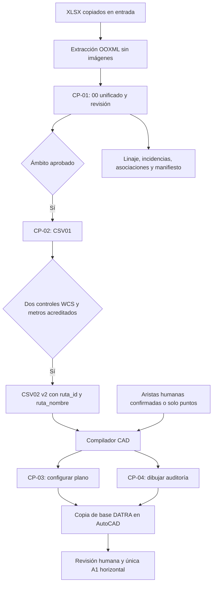

# Pipeline de Auditorías CFE | DATRA

Pipeline local Python para preparar inventarios XLSX y compilar dos scripts para AutoCAD convencional 2026 en inglés. Trabaja sobre copias, conserva el linaje y separa identificación, admisión geográfica, proyección y aceptación humana.

**Estado, 2026-11-05:** software CP-01 a CP-04 implementado; evidencia geográfica y aceptación de planos reales pendientes. La suite original de 43 pruebas se conserva: **80 pruebas locales aprobadas**, sin fallidas ni omitidas. Resultados ejecutados, conteos y gates: [acta integral](AuditoriaCFE/Codex/02_Harness_Integral/acta_fase_6.md). CI técnico no equivale a aprobación productiva.

| Checkpoint | Producto | Condiciones |
|---|---|---|
| CP-01 | `00_elementos_unificados.csv` (12 columnas), bandeja `00_elementos_revision.csv` | Identidad exacta, prevalencia explícita, ocurrencias y rutas trazables. Funciona sin P-03/P-06. |
| CP-02 | `01_elementos_normalizados.csv` (3 columnas), `02_elementos_proyectados.csv` v2 | 01 exige admisión geográfica; 02 requiere además dos controles reales WCS/WGS84 y tolerancia acreditada. Lector 02 v1 compatible. |
| CP-03 | `01_configurar_plano.scr` + LISP empaquetado | Abre exclusivamente la copia DWG indicada. Configura capas, bloques y A1 sin duplicar mapa ni insertar postes. |
| CP-04 | `02_dibujar_auditoria.scr` | Bloques y etiquetas por ID, conteos reales y aristas humanas confirmadas. Sin confirmaciones, solo puntos preliminares. |

Los cuatro checkpoints conservan los dos procesos arquitectónicos: preparación/compilación fuera de AutoCAD y construcción/revisión dentro de AutoCAD. Los únicos dos pasos de scripts del operador son SCR01 y SCR02. No se certifica una DWT por renombrar un DWG.



El modo `--diagnostico` es opt-in: proyección candidata en archivo **distinto** `02_DIAGNOSTICO_NO_VERIFICADO.csv`, copia DWG y puntos rotulados. No crea CSV02 productivo ni elimina los gates de CRS, papel o FINAL. `EPSG:32611` continúa como candidato hasta controles reales; no se aplica el offset del JS histórico.

## Instalación y uso

Desde la raíz del repositorio, con Python >=3.10:

```powershell
python -m venv AuditoriaCFE/.venv
& ./AuditoriaCFE/.venv/Scripts/python.exe -m pip install -r AuditoriaCFE/requirements.txt
& ./AuditoriaCFE/.venv/Scripts/python.exe -m unittest discover -s AuditoriaCFE/tests -v
& ./AuditoriaCFE/.venv/Scripts/python.exe AuditoriaCFE/preparar_auditoria.py --help
& ./AuditoriaCFE/.venv/Scripts/python.exe AuditoriaCFE/preparar_auditoria.py --auditoria Mirador --dry-run
& ./AuditoriaCFE/.venv/Scripts/python.exe AuditoriaCFE/preparar_auditoria.py --batch
& ./AuditoriaCFE/.venv/Scripts/python.exe AuditoriaCFE/preparar_auditoria.py --batch --verificar-paquete
```

Sin argumento se ofrece selección interactiva. `--preparar-entradas` copia únicamente las fuentes exactas declaradas por el encargo y registra hashes; requiere históricos locales. Las cuatro auditorías son Natura, Mirador, Otay-Florido y Tijuana-General. Cada una tiene configuración y lote independientes; una falla no cancela el resto. El resumen batch queda separado bajo `auditorias/_batch/salida/`.

## Reglas y custodia

- Histórico inmutable. No ejecutar JS ni guardar DWG sobre originales. No publicar XLSX/KMZ, aristas/resoluciones reales, nuevos recursos propietarios ni salidas privadas.
- Deduplicación por tipo canónico y coordenadas decimales exactas, sin redondeo, con excepción de cajas con IDs confiables distintos. Prevalencia no implica orden físico de una ruta.
- `Registro` queda FUERA_ALCANCE. Coordenadas imposibles y decisiones de exclusión permanecen en linaje. Sin baseline histórica, novedad `NO_DETERMINADO`.
- Maestro Postes_CFE: comparación informativa; no filtra los planos individuales. KMZ y cercanía solo producen propuestas. No se dibujan los tres anillos por su mera declaración.
- Una A1 horizontal con etiquetas completas. Si General no resulta legible, bloquea FINAL y requiere excepción explícita; no se crean hojas adicionales ni se ocultan requisitos.
- Manifiesto v2 activo e historial dentro de `salida/`, con hashes de artefactos, entradas y configuración. Migración recuperable del esquema anterior. Los DWG/PDF nativos mutables permanecen separados en `salida/resultados_cad/`.

La [auditoría JS ejecutada](AuditoriaCFE/Codex/01_Implementacion_Proceso1/AUDITORIA_JS_HISTORICOS.md) contrastó 533/965 puntos históricos: `ordenar.js` retorna por aristas; `trayectoria.js` puede crear atajos entre ramas. Ningún algoritmo histórico se adopta como autoridad física. El oráculo congelado mantiene la regresión sin depender de `git show` ni de historial profundo.

## Autoridad y documentación

[ADR-000](AuditoriaCFE/Docs/ADRs/ADR-000_Decisiones_Base_Pipeline_Auditorias_CFE.md) más las enmiendas explícitas de [ADR-001](AuditoriaCFE/Docs/ADRs/ADR-001_Enmienda_Cierre_2026-11-05.md), [TO-BE v0.3](AuditoriaCFE/Docs/Specs/Especificacion_Pipeline_Auditorias_CFE_TOBE_v0.3.md) y [contrato P-09 v1](AuditoriaCFE/Docs/Specs/Contrato_Salidas_Pipeline_P09_v1.md). La v0.2 se conserva como referencia histórica.

[Operación detallada](AuditoriaCFE/README.md) · [Plan integral](AuditoriaCFE/Codex/02_Harness_Integral/02_PLAN_IMPLEMENTACION.md) · [Pruebas](AuditoriaCFE/Codex/01_Implementacion_Proceso1/PRUEBAS_Y_VALIDACION.md) · [Pendientes](AuditoriaCFE/Codex/01_Implementacion_Proceso1/PENDIENTES_PARA_REVISION.md).
